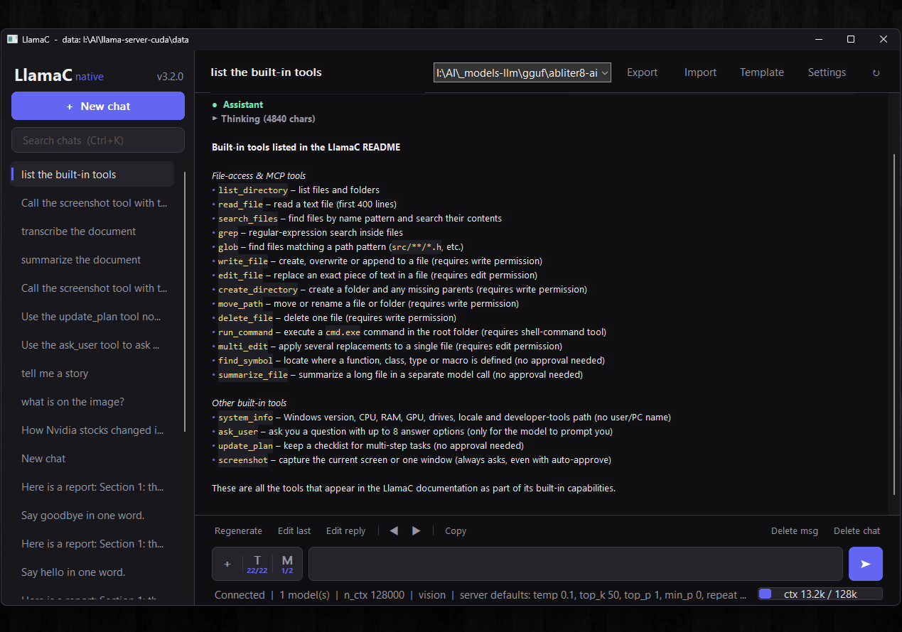
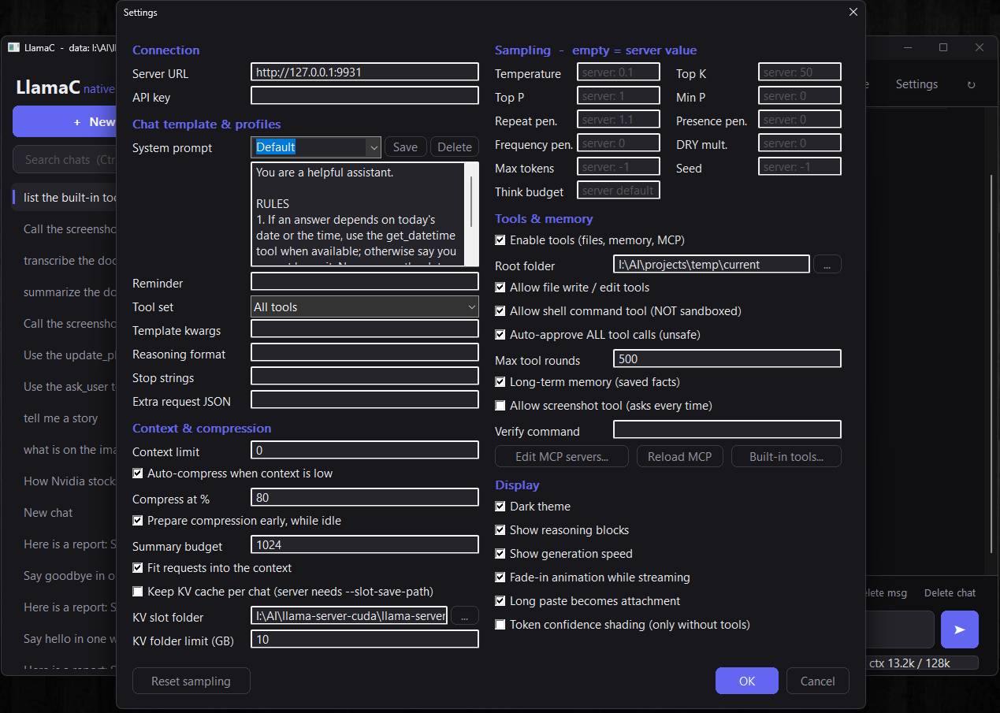

# LlamaC

**A native Win32 client for [llama-server](https://github.com/ggml-org/llama.cpp) written in pure C.** A single small `.exe`, no runtime, no Electron, no browser. It aims to feel like the llama.cpp WebUI. `Only 4MB of memory usage`.

   

 

## Features

- **Streaming chat** over llama-server's OpenAI-compatible API, with live token streaming and generation speed stats.
- **Tool calling.** Built-in file tools and MCP servers (stdio and HTTP), with a per-call approval dialog. See [Tools](#tools-file-access-and-mcp).
- **Long-term memory.** Facts the model saves are stored locally and injected into every chat. See [Memory](#long-term-memory).
- **Branching conversations.** Regenerate or edit a message and flip between alternatives (`‹ 1 / 2 ›`).
- **Reasoning support.** Collapsible "Thinking" blocks for `reasoning_content` and inline `<think>` tags.
- **Rich rendering** in a native RichEdit control: Markdown (headings, lists, quotes, tables, inline code), syntax-highlighted code blocks with **Copy** and **Download** buttons. Long code lines wrap inside the block.
- **Clickable links.** `[text](url)` links and bare `http(s)://` URLs open in your default browser. Only `http`, `https` and `mailto` links are opened.
- **Context management for small models.** Old tool results are shortened before anything is summarized, every request is fitted into the context, and a gauge shows how full it is. See [Context compression](#context-compression) and [Getting the most from small models](#getting-the-most-from-small-models).
- **Profiles.** A saved prompt also keeps a reminder, a tool set, sampling values, a reasoning budget and template kwargs.
- **Edit a reply and continue.** Correct the model's answer and let it go on from your text, as a new branch. This also continues a reply that hit the token limit.
- **Token confidence.** Words the model was unsure about are shaded. Click one to see the alternatives and continue from another choice.
- **File checkpoints.** Files changed by tools are saved first. Going back to an earlier message can restore them.
- **Attachments.** Images, audio (`.mp3`, `.wav`) and text files, via the button, drag and drop onto the window, the input box or the chat view, a long paste that becomes an attachment, or **Ctrl+V of a screenshot or of files copied in Explorer**.
- **Message queue.** Press Enter while the model is working, and the message is sent when the reply is complete.
- **Server-default aware settings.** Sampling parameters left empty are _not sent_, so llama-server's own values apply. Settings are read from `GET /props`.
- **Full sampling control:** temperature, top-k, top-p, min-p, repeat/presence/frequency penalty, DRY, max tokens, seed, stop strings.
- **Advanced:** Jinja `chat_template_kwargs`, `reasoning_format`, extra request JSON, and a **Jinja template viewer** (`POST /apply-template`).
- **WebUI-compatible import/export** of chats as JSON.
- **Search** across chat titles and contents.
- **Chat list menu.** Right-click a chat (or press Shift+F10) to **Rename** it or **Copy original prompt**.
- **Dark and light themes** with a Windows 11 style frame (DWM).
- **Portable.** Data is stored in a `data\` folder next to the exe. If that isn't writable, it falls back to `%APPDATA%\llamac`, then `%TEMP%\llamac`.

## Quick start

1. Start a llama.cpp server. Add `--jinja` if you want tools or memory, because the server needs it to parse tool calls:
    ```bat
    llama-server -m model.gguf --port 9931 --jinja
    ```
2. Run `llamac.exe`. Set the server URL, and optionally an API key, under **Settings**.

## Settings

Settings are grouped into sections: **Connection**, **Chat template**, **Display**, **Sampling**, **Tools & memory** and **Context & compression**. Hover any label or field for an explanation of what it does and what an empty value or `0` means.

Sampling fields left empty are not sent, so llama-server's own values apply. The grey hint in each box shows the server value. **Reset sampling** clears all sampling overrides.

The **System prompt** can hold up to 4095 bytes (accented characters take 2 bytes). **Save** and **Delete** next to the name box keep named prompts in `data\prompts.json`. To change the limit, edit the size of `sys` in `src/config.h` and rebuild. Model names of any length are supported.

## Tools: file access and MCP

Tools are sent to the model in the `tools` field of each chat request, so you don't need to mention them in the system prompt. The model decides when to call one. Every call shows an approval dialog (**Allow once**, **Always allow this tool (until restart)**, **Deny**) unless the tool is read-only or auto-approved. Up to **Max tool rounds** calls are chained per message.

Turn everything on or off with **Enable tools** in Settings. The model must support tool calling and the server must run with `--jinja`.

### Date and time

`get_datetime` returns the current local date, weekday, time and UTC offset from your computer, so the model never has to guess the date. It is read-only (no approval) and available whenever **Enable tools** is on, with or without a root folder.

### File tools

| Tool               | Purpose                                       | Asks first |
| ------------------ | --------------------------------------------- | ---------- |
| `list_directory`   | List files and folders                        | no         |
| `read_file`        | Read a text file, optionally a line range     | no         |
| `search_files`     | Find files by wildcard and search their text  | no         |
| `grep`             | Regular-expression search in file contents    | no         |
| `glob`             | Find files by path pattern (`src/**/*.h`)     | no         |
| `write_file`       | Create, overwrite or append to a file         | yes        |
| `edit_file`        | Replace an exact piece of text (once, or all) | yes        |
| `create_directory` | Create a folder and missing parents           | yes        |
| `move_path`        | Move or rename a file or folder               | yes        |
| `delete_file`      | Delete one file                               | yes        |
| `run_command`      | Run a `cmd.exe` command, return its output    | yes        |

- The tools are limited to the **Root folder** set in Settings (type it or pick it with **...**). Paths are resolved to their real location, so links and junctions cannot escape the root. With no root folder there are no file tools.
- Write, move and delete tools only exist when **Allow file write / edit tools** is ticked.
- `run_command` only exists when **Allow shell command tool** is ticked. It starts in the root folder, but the command itself can reach anything your Windows account can. It is not sandboxed.
- `read_file` without `offset`/`limit` returns the first 400 lines and says how many the file has.
- `edit_file` first looks for an exact match. If there is none, it matches line by line ignoring indentation, trailing spaces and the width of inner whitespace, and re-indents the new text to the file. The result says when this happened. When nothing matches, the error shows the file's actual lines near the best guess.
- The approval dialog of `edit_file`, `write_file` and `delete_file` shows a **diff** of what would change instead of raw JSON.
- Before a write, edit, move or delete, the file's previous content is saved in `data\checkpoints\<chat>\`. When you use **Edit last** to go back before those tool calls, llamac asks whether to restore the files.
- **Verify command** (Settings): runs after every tool round that changed files, for example `build.bat` or `npm test`. Its output is added to the tool result, so the model sees build errors straight away. It runs in the root folder without asking, because it is your own command.
- Read-only tools called together in one round run in parallel.
- Tool results are capped at 60,000 characters, and at about 40% of the free context (shared by the calls of one round). Command output keeps its end, where errors are; other output keeps its beginning. ANSI colours, progress redraws and repeated warning lines are removed from command output.
- **Tool set** (Settings, or per profile): *All tools*, *Chat* (date, memory, guides and MCP only) or *None*.

### Guides

Put Markdown files in `data\guides\` (for example `coding-rules.md`). The first line of each file is its description. When guides exist, the model gets a `read_guide` tool. Only the names and descriptions are sent with each request; the model reads a guide when the task needs it. Long rules that otherwise sit in the system prompt then cost tokens only when they are used.

### MCP servers

Click **Edit MCP servers...** in Settings to open the built-in `mcp.json` editor (JSON is validated on save). Click **Reload MCP** to connect, and the result appears in the status bar. Both transports are implemented with no third-party code.

```json
{
    "mcpServers": {
        "files": {
            "command": "npx",
            "args": ["-y", "@modelcontextprotocol/server-filesystem", "C:\MCP"],
            "env": {},
            "autoApprove": ["read_file"],
            "timeout": 60
        },
        "remote": {
            "url": "http://127.0.0.1:3000/mcp",
            "headers": { "Authorization": "Bearer TOKEN" }
        },
        "off": { "command": "x", "disabled": true }
    }
}
```

| Key           | Meaning                                                                   |
| ------------- | ------------------------------------------------------------------------- |
| `command`     | Start a stdio server (`.cmd` launchers such as `npx` are run through cmd) |
| `args`, `env` | Arguments, and extra environment variables                                |
| `cwd`         | Working directory for the child process                                   |
| `url`         | Use the Streamable HTTP transport (JSON and SSE replies)                  |
| `headers`     | Extra HTTP headers, for example authorization                             |
| `autoApprove` | `true`, or a list of tool names that run without asking                   |
| `timeout`     | Seconds per request (default 60)                                          |
| `disabled`    | Skip this server                                                          |

MCP tools appear to the model as `servername__toolname`.

**Switching servers on and off:** the **MCP 2/3** button next to the attach button in the input box lists the servers in `mcp.json` with a check mark (and their tool count, or the error if one failed to start). Clicking a server stops it - its process ends and its tools are no longer sent - or starts it again; the menu stays open so several can be switched. The choice is kept in llamac's settings across restarts, `mcp.json` is not changed. Servers with `"disabled": true` in `mcp.json` are shown greyed. The menu also has **Reload all servers** and **Edit mcp.json**. Servers cannot be switched while a reply is being generated. Stdio servers run inside a Windows job object, so the whole process tree is killed when llamac closes.

## Long-term memory

llamac keeps a small local memory so the model remembers you across chats.

- Facts are stored in `memory.json` in the data folder (up to 500; the oldest unpinned entry is dropped when full).
- A digest is added to the system message of every request: pinned facts first, then the facts most relevant to the chat's first message (BM25 keyword ranking), then the newest. It is chosen once per chat, so the server's prompt cache stays valid. The model does not need to call a tool to recall them.
- Tools: `memory_save` (also updates duplicates), `memory_search`, `memory_list`, `memory_delete`. Save, search and list run without asking, and delete asks first.
- Toggle it with **Long-term memory** in Settings. You can review or edit `memory.json` in any editor.

## Context compression

With **Auto-compress when context is low** ticked, llamac keeps long chats within the server's context window.

- **When:** before each request, llamac estimates the prompt size: the last measured token count, plus anything added since (such as a large tool result) at the model's measured characters per token. Compression starts when the estimate passes the threshold. It is also checked after every reply.
- **Threshold:** **Compress at %** of the context. `0` = auto, which keeps `max(15%, 4096 tokens)` free for the reply. Values are limited to 30-95%.
- **Context size:** the server's `n_ctx` from `/props`, or **Context limit** if you set one (for example to compress earlier than the server requires).
- **Step 1, instant:** tool results from before your latest message are replaced by a one-line stub in requests ("Earlier result of read_file(...) removed to save context: 412 lines ... call the tool again if you still need it"). The chat keeps the full text, and the view marks those results as shortened. In agent work this step is often enough, and no model call is needed.
- **Step 2, summary:** only if step 1 did not free enough, the oldest ~70% of the messages are sent to the model to summarize. The summary uses fixed sections (goal, current state, decisions and constraints, facts and identifiers, open questions) and merges an earlier summary. It replaces those messages at the top of the chat ("Summary of earlier messages") and is added to the system message of later requests. The original messages stay available: the previous branch (`‹`) on the summary shows them. The chat's first prompt is kept with the summary and sent to the model along with it. It is not shown in the chat, but **Copy original prompt** in the chat list menu still copies it.
- **Summary reasoning budget:** reasoning models think before they write the summary. **Summary budget** (default 1024 tokens) caps that thinking with llama-server's `reasoning_budget_tokens`, which recent llama-server builds support. Without a cap, a 27B Qwen3 model needed about 3 minutes for an 8k-token transcript. The status bar shows the progress while the summary streams.
- **Early, while idle:** with **Prepare compression early** ticked, the work starts after a reply once the context is above 85% of the threshold, while you read. A message you send that still fits cancels it.
- **Waiting:** a message sent, or a tool round started, while a needed compression runs waits for it, so the request is built from the compressed chat. **Stop** cancels the wait and the compression, and closing the request stops the server generating.
- **If it fails,** the status bar shows the reason (server unreachable, timeout, HTTP error, empty reply). The same chat is not retried until it has grown by a few more messages.
- **Fitting:** with **Fit requests into the context** ticked, a request that would still not fit is adjusted when it is sent, without changing the chat. In order, llamac:
  1. shortens old tool results;
  2. shortens the current turn's tool results except the newest two;
  3. clips what is still too large (keeping its beginning and end);
  4. as a last resort, leaves out whole early turns.

  A single huge tool result therefore no longer causes a server error.
- **What is in the context:** click the gauge right of the status bar. It shows token counts from the server's tokenizer for the system prompt, memory, summary, tool definitions, messages, tool results and attachments, the largest tool results, and the model's statistics. It also has buttons to shorten old tool results or compress now.

## Getting the most from small models

Small (9B-35B) models lose track of instructions in long contexts, choose wrong tools when they have many, and often get whitespace wrong when editing. These settings address that:

- **Tool set** *Chat* or *None* for conversations that need no files: the file tool definitions alone are about 1.5k tokens per request.
- **Reminder** (in a profile): a line such as "Answer in Hungarian. Keep it short." is appended to your latest message when it is sent. It is not stored, and the prompt cache stays valid.
- **Guides** instead of a long system prompt (see [Guides](#guides)).
- **Think budget** (sampling) and **Summary budget** limit reasoning tokens (`reasoning_budget_tokens`, recent llama-server builds).
- **Profiles:** **Save** next to the prompt name stores the prompt with the reminder, tool set, temperature, top-k, top-p, min-p, think budget and kwargs. Picking the profile sets them all. This fits per-model recommended sampling values.
- **Edit reply:** correct the one wrong step of an answer and let the model continue from there (llama-server continues a final assistant message), instead of regenerating everything.
- **Token confidence** (Display): needs requests without tools (Tool set *None*), because llama-server does not stream token probabilities together with tools. Words below 50% are shaded, and strongly below 20%. Clicking one lists the alternatives and their probabilities. Picking one keeps the answer up to that word and continues from the alternative, as a new branch.
- **Per-model statistics** (`data\model_stats.json`, shown in the context window): replies cut at max tokens, invalid tool arguments, `edit_file` misses and whitespace-tolerant matches. The measured characters per token make the context estimates and the fitting accurate for each model.

### KV cache per chat

With **Keep KV cache per chat**, llamac saves the server's KV cache (slot 0) under the chat's id when you switch to another chat, and restores it when you come back. A long chat then does not have to be processed again. Measured with a 27B Qwen model: going back to a 7.3k-token chat took 0.6 s to restore and 3.6 s to answer, instead of about 10 s of prompt processing. This needs `llama-server --slot-save-path <folder>`, and requests are then pinned to slot 0. Only chats saved before are restored (their ids are listed in `data\kvslots.txt`).

The saved files are large: with that model 0.5-1 GB per chat, even for a short chat. llama-server has no API to delete them. When llama-server runs on the same PC, set **KV slot folder** to its `--slot-save-path`: a full path, or one relative to the folder of `llamac.exe` such as `llama-server\slot-save`. The **...** button opens a folder picker, and quotes from Explorer's "Copy as path" are removed. llamac then checks that a chat's file exists before restoring it, deletes the file together with the chat, and deletes the oldest files when they use more than **KV folder limit** (default 10 GB). Only files named `llamac-*.bin` are deleted.

Recent llama-server builds also keep a prompt cache in RAM across chats. While a chat is still in that cache it is reused even without this option. The saved files help when a chat has dropped out of it, and after a server restart.

## Build

Requirements: Visual Studio 2022 (MSVC) on x64 Windows. No third-party libraries.

Open **x64 Native Tools Command Prompt for VS 2022** and run `build.bat`.

Link libraries are pulled in through `#pragma comment`. `build.bat` also embeds the application manifest (`/MANIFEST:EMBED`), which enables Common Controls v6. Without it, tooltips, grey hint text and themed controls do not appear. If you build by hand, keep those flags:

```bat
cl /O2 /W3 /utf-8 llamac.c /link /MANIFEST:EMBED "/MANIFESTUAC:level='asInvoker' uiAccess='false'"
```

The version string is `LLAMAC_VERSION` at the top of `llamac.c`.

### File tools fail with "Win32 error 5"

If write_file reports `Win32 error 5` and the diagnostic shows `integrity=0x1000`,
llamac is running at Low integrity, usually because the exe or its folder has a Low
mandatory label (some sandboxing tools leave one behind). Check with
`icacls llamac.exe` and look for `Mandatory Label\Low Mandatory Level`, then
relabel the folder from an elevated prompt:

    icacls "<project folder>" /setintegritylevel "(OI)(CI)M" /T /C

Then rebuild.

## Keyboard shortcuts

| Shortcut       | Action         |
| -------------- | -------------- |
| `Ctrl+Shift+N` | New chat       |
| `Ctrl+Shift+D` | Delete chat    |
| `Ctrl+K`       | Search chats   |
| `Ctrl+B`       | Toggle sidebar |
| `Enter` while the model works | Queue the message (Stop puts it back in the box) |
| `Ctrl+V`       | Paste text, a screenshot (attached as PNG) or files copied in Explorer |
| `Shift+F10`    | Menu for the selected chat in the list (right-click works too) |

## Project layout

The project is a unity build: `llamac.c` includes the modules in `src/` in dependency order, so everything compiles as one translation unit. **Order matters**: a function must be defined before it is used, otherwise MSVC assumes an `int` return type and reports redefinition errors.

```text
llamac.c            entry point, includes all modules
build.bat
src/
  util.h            string builder, allocation helpers
  json.h            tiny JSON DOM parser
  config.h          settings struct, field table, serialisation
  chat_tree.h       conversation tree, attachments
  tools_core.h      JSON dump, streamed tool_calls accumulator, UTF-8 sanitiser
  request.h         request body and /apply-template builders
  chat_io.h         WebUI-compatible import/export
  win_base.h        Windows includes, control IDs, global state
  win_util.h        UTF-8/16, file I/O, base64
  theme.h           colours, DWM frame, owner-drawn controls
  richtext.h        RichEdit output primitives
  highlight.h       syntax highlighter
  codeblocks.h      code blocks, Copy/Download links
  markdown.h        Markdown renderer
  render.h          thinking blocks, streaming, render_all
  storage.h         data directory, persistence
  conv_list.h       sidebar list and search
  attachments.h     attachment loading
  http.h            WinHTTP helpers
  worker.h          streaming worker thread
  text_window.h     read-only text window
  actions.h         send, regenerate, edit, delete, branch
  tools.h           tool registry, approval dialog, executor, runner thread
  memory.h          long-term memory store, tools, system-prompt digest
  mcp.h             MCP client core, mcp.json loading, built-in editor
  mcp_stdio.h       MCP over stdio (pipes, job object)
  mcp_http.h        MCP over Streamable HTTP (WinHTTP, SSE)
  tools_fs.h        sandboxed file tools
  settings_ui.h     settings dialog and profiles
  main_window.h     window procedure, layout, context gauge, WinMain
  compact.h         chat compression (tool-result stubs, streaming summary)
  ctxview.h         "What is in the context" window
  checkpoint.h      file checkpoints for rewinding a chat
  modelstats.h      per-model statistics and characters-per-token calibration
tests/
  textops_tests.c   whitespace-tolerant edit, log folding, diff, BM25
  request_tests.c   request building: stubs, reminder, fitting, logprobs, prefill
```

The portable modules (`util`, `json`, `config`, `chat_tree`, `tools_core`, `request`) use no Windows APIs. The tests build with `cl /nologo /W3 /utf-8 tests\textops_tests.c` (and `request_tests.c`) and need no Windows UI.

## How it talks to the server

| Endpoint                    | Purpose                                                                                 |
| --------------------------- | --------------------------------------------------------------------------------------- |
| `POST /v1/chat/completions` | Streaming chat (`stream: true`, `timings_per_token: true`, `return_progress: true`) and the streaming summary |
| `GET /props`                | Reads server default sampling values and the context size                               |
| `POST /apply-template`      | Renders the chat template without running inference                                     |
| `POST /tokenize`            | Token counts in the context window                                                     |
| `POST /slots/0?action=save` / `restore` | KV cache per chat (optional, needs `--slot-save-path`)                     |

Only parameters you set in the client are included in the request. When tools are enabled, the request also carries the `tools` array, and tool results are sent back as `tool` messages.

## Security notes

- Tool calls are executed with your Windows account's permissions. Keep approval prompts on for write tools and for MCP servers you do not fully trust.
- MCP servers are programs you start. Only add servers you trust.
- `Auto-approve ALL tool calls` skips every prompt, including writes, deletes and shell commands. Combined with the shell tool, the model can run any command without asking.
- Links in model output are only opened when you click them, and only `http`, `https` and `mailto` links.

## Limitations

- Windows only (Win32, WinHTTP, RichEdit, DWM).
- Tools need a model with tool-calling support and `llama-server --jinja`.
- MCP support covers tools only (no resources, prompts or sampling), and server-initiated requests other than `ping` are declined.
- PDF attachments are not supported. Convert them to text or images first.
- Token confidence works only in requests without tools (a llama-server restriction).
- Attachments are limited to 100 MB per file.
- Markdown rendering is a lightweight subset, not a full CommonMark implementation.

## Contributing

Issues and pull requests are welcome. Keep the code dependency-free and make sure it builds cleanly with `/W3`.

## License

MIT
