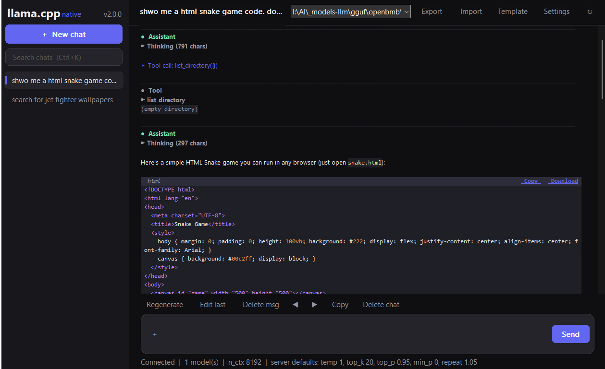
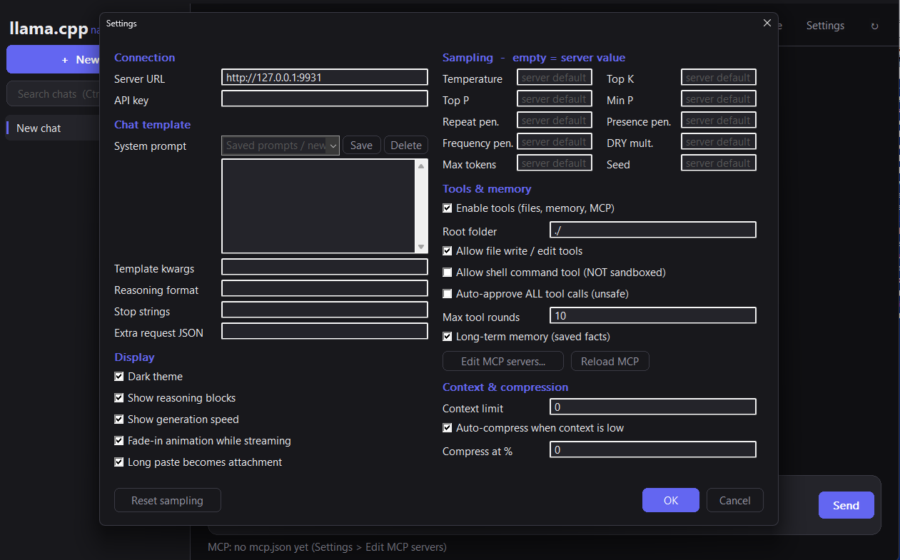

# LlamaC

**A native Win32 client for [llama-server](https://github.com/ggml-org/llama.cpp) written in pure C.** A single small `.exe`, no runtime, no Electron, no browser. It aims to feel like the llama.cpp WebUI. `Only 4MB of memory usage`.

   

 

## Features

- **Streaming chat** over llama-server's OpenAI-compatible API, with live token streaming and generation speed stats.
- **Tool calling.** Built-in file tools and MCP servers (stdio and HTTP), with a per-call approval dialog. See [Tools](#tools-file-access-and-mcp).
- **Long-term memory.** Facts the model saves are stored locally and injected into every chat. See [Memory](#long-term-memory).
- **Branching conversations.** Regenerate or edit a message and flip between alternatives (`‹ 1 / 2 ›`).
- **Reasoning support.** Collapsible "Thinking" blocks for `reasoning_content` and inline `<think>` tags.
- **Rich rendering** in a native RichEdit control: Markdown (headings, lists, quotes, tables, links, inline code), syntax-highlighted code blocks with **Copy** and **Download** buttons.
- **Attachments.** Images, audio (`.mp3`, `.wav`) and text files, via the button, drag and drop, or long paste that becomes an attachment.
- **Server-default aware settings.** Sampling parameters left empty are _not sent_, so llama-server's own values apply. Settings are read from `GET /props`.
- **Full sampling control:** temperature, top-k, top-p, min-p, repeat/presence/frequency penalty, DRY, max tokens, seed, stop strings.
- **Advanced:** Jinja `chat_template_kwargs`, `reasoning_format`, extra request JSON, and a **Jinja template viewer** (`POST /apply-template`).
- **WebUI-compatible import/export** of chats as JSON.
- **Search** across chat titles and contents.
- **Dark and light themes** with a Windows 11 style frame (DWM).
- **Portable.** Data is stored in a `data\` folder next to the exe. If that isn't writable, it falls back to `%APPDATA%\llamac`, then `%TEMP%\llamac`.

## Quick start

1. Start a llama.cpp server. Add `--jinja` if you want tools or memory, because the server needs it to parse tool calls:
    ```bat
    llama-server -m model.gguf --port 9931 --jinja
    ```
2. Run `llamac.exe`. The default server URL is `http://127.0.0.1:9931`. Change it, and optionally set an API key, under **Settings**.

## Tools: file access and MCP

Tools are sent to the model in the `tools` field of each chat request, so you don't need to mention them in the system prompt. The model decides when to call one. Every call shows an approval dialog (**Allow once**, **Always allow this tool (until restart)**, **Deny**) unless the tool is read-only or auto-approved. Up to **Max tool rounds** calls are chained per message.

Turn everything on or off with **Enable tools** in Settings. The model must support tool calling and the server must run with `--jinja`.

### File tools

| Tool               | Purpose                                       | Asks first |
| ------------------ | --------------------------------------------- | ---------- |
| `list_directory`   | List files and folders                        | no         |
| `read_file`        | Read a text file, optionally a line range     | no         |
| `search_files`     | Find files by wildcard and search their text  | no         |
| `write_file`       | Create, overwrite or append to a file         | yes        |
| `edit_file`        | Replace an exact piece of text (once, or all) | yes        |
| `create_directory` | Create a folder and missing parents           | yes        |

- The tools are limited to the **File tools root folder** set in Settings. Paths are resolved to their real location, so links and junctions cannot escape the root.
- Write, edit and create tools only exist when **Allow file write/edit tools** is ticked.
- Set the root to `*` for **unrestricted mode**: any path your Windows account can access. In this mode the read tools also ask for approval. Windows permissions still apply.
- Do not combine unrestricted mode with **Auto-approve ALL tool calls**.

### MCP servers

Click **Edit MCP servers...** in Settings to open the built-in `mcp.json` editor (JSON is validated on save). Click **Reload MCP** to connect, and the result appears in the status bar. Both transports are implemented with no third-party code.

```json
{
    "mcpServers": {
        "files": {
            "command": "npx",
            "args": ["-y", "@modelcontextprotocol/server-filesystem", "I:\\AI"],
            "env": {},
            "autoApprove": ["read_file"],
            "timeout": 60
        },
        "remote": {
            "url": "http://127.0.0.1:3000/mcp",
            "headers": { "Authorization": "Bearer TOKEN" }
        },
        "off": { "command": "x", "disabled": true }
    }
}
```

| Key           | Meaning                                                                   |
| ------------- | ------------------------------------------------------------------------- |
| `command`     | Start a stdio server (`.cmd` launchers such as `npx` are run through cmd) |
| `args`, `env` | Arguments, and extra environment variables                                |
| `cwd`         | Working directory for the child process                                   |
| `url`         | Use the Streamable HTTP transport (JSON and SSE replies)                  |
| `headers`     | Extra HTTP headers, for example authorization                             |
| `autoApprove` | `true`, or a list of tool names that run without asking                   |
| `timeout`     | Seconds per request (default 60)                                          |
| `disabled`    | Skip this server                                                          |

MCP tools appear to the model as `servername__toolname`. Stdio servers run inside a Windows job object, so the whole process tree is killed when llamac closes.

## Long-term memory

llamac keeps a small local memory so the model remembers you across chats.

- Facts are stored in `memory.json` in the data folder (up to 500; the oldest unpinned entry is dropped when full).
- A digest is added to the system message of every request, pinned facts first, then the newest. The model does not need to call a tool to recall them.
- Tools: `memory_save` (also updates duplicates), `memory_search`, `memory_list`, `memory_delete`. Save, search and list run without asking, and delete asks first.
- Toggle it with **Long-term memory** in Settings. You can review or edit `memory.json` in any editor.

## Build

Requirements: Visual Studio 2022 (MSVC) on x64 Windows. No third-party libraries.

Open **x64 Native Tools Command Prompt for VS 2022**, then:

```bat
cl /O2 /W3 /utf-8 llamac.c
```

or run `build.bat`. Link libraries are pulled in through `#pragma comment`, so no extra flags are needed. The version string is `LLAMAC_VERSION` at the top of `llamac.c`.

## Keyboard shortcuts

| Shortcut       | Action         |
| -------------- | -------------- |
| `Ctrl+Shift+N` | New chat       |
| `Ctrl+Shift+D` | Delete chat    |
| `Ctrl+K`       | Search chats   |
| `Ctrl+B`       | Toggle sidebar |

## Project layout

The project is a unity build: `llamac.c` includes the modules in `src/` in dependency order, so everything compiles as one translation unit. **Order matters**: a function must be defined before it is used, otherwise MSVC assumes an `int` return type and reports redefinition errors.

```text
llamac.c            entry point, includes all modules
build.bat
src/
  util.h            string builder, allocation helpers
  json.h            tiny JSON DOM parser
  config.h          settings struct, field table, serialisation
  chat_tree.h       conversation tree, attachments
  tools_core.h      JSON dump, streamed tool_calls accumulator, UTF-8 sanitiser
  request.h         request body and /apply-template builders
  chat_io.h         WebUI-compatible import/export
  win_base.h        Windows includes, control IDs, global state
  win_util.h        UTF-8/16, file I/O, base64
  theme.h           colours, DWM frame, owner-drawn controls
  richtext.h        RichEdit output primitives
  highlight.h       syntax highlighter
  codeblocks.h      code blocks, Copy/Download links
  markdown.h        Markdown renderer
  render.h          thinking blocks, streaming, render_all
  storage.h         data directory, persistence
  conv_list.h       sidebar list and search
  attachments.h     attachment loading
  http.h            WinHTTP helpers
  worker.h          streaming worker thread
  text_window.h     read-only text window
  actions.h         send, regenerate, edit, delete, branch
  tools.h           tool registry, approval dialog, executor, runner thread
  memory.h          long-term memory store, tools, system-prompt digest
  mcp.h             MCP client core, mcp.json loading, built-in editor
  mcp_stdio.h       MCP over stdio (pipes, job object)
  mcp_http.h        MCP over Streamable HTTP (WinHTTP, SSE)
  tools_fs.h        sandboxed file tools
  settings_ui.h     settings dialog
  main_window.h     window procedure, layout, WinMain
```

The portable modules (`util`, `json`, `config`, `chat_tree`, `tools_core`, `request`) use no Windows APIs.

## How it talks to the server

| Endpoint                    | Purpose                                                    |
| --------------------------- | ---------------------------------------------------------- |
| `POST /v1/chat/completions` | Streaming chat (`stream: true`, `timings_per_token: true`) |
| `GET /props`                | Reads server default sampling values                       |
| `POST /apply-template`      | Renders the chat template without running inference        |

Only parameters you set in the client are included in the request. When tools are enabled, the request also carries the `tools` array, and tool results are sent back as `tool` messages.

## Security notes

- Tool calls are executed with your Windows account's permissions. Keep approval prompts on for write tools and for MCP servers you do not fully trust.
- MCP servers are programs you start. Only add servers you trust.
- `Auto-approve ALL tool calls` skips every prompt, and is unsafe with unrestricted file access.

## Limitations

- Windows only (Win32, WinHTTP, RichEdit, DWM).
- Tools need a model with tool-calling support and `llama-server --jinja`.
- MCP support covers tools only (no resources, prompts or sampling), and server-initiated requests other than `ping` are declined.
- PDF attachments are not supported. Convert them to text or images first.
- Attachments are limited to 100 MB per file.
- Markdown rendering is a lightweight subset, not a full CommonMark implementation.

## Contributing

Issues and pull requests are welcome. Keep the code dependency-free and make sure it builds cleanly with `/W3`.

## License

MIT
