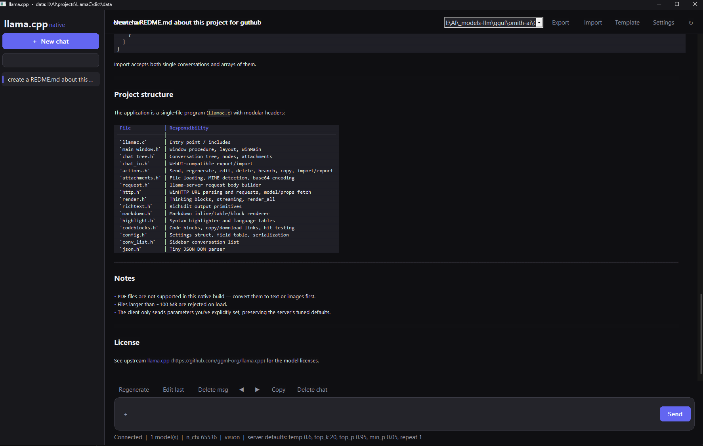
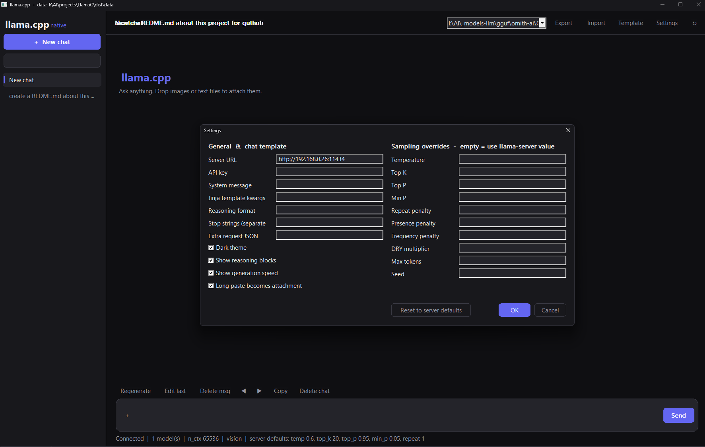

# LlamaC

**A native Win32 client for [llama-server](https://github.com/ggml-org/llama.cpp) written in pure C.** A single small `.exe`, no runtime, no Electron, no browser. It aims to feel like the llama.cpp WebUI.

  

 

## Features

- **Streaming chat** over llama-server's OpenAI-compatible API, with live token streaming and generation speed stats.
- **Branching conversations.** Regenerate or edit a message and flip between alternatives (`‹ 1 / 2 ›`).
- **Reasoning support.** Collapsible "Thinking" blocks for `reasoning_content` and inline `<think>` tags.
- **Rich rendering** in a native RichEdit control: Markdown (headings, lists, quotes, tables, links, inline code), syntax-highlighted code blocks with **Copy** and **Download** buttons.
- **Attachments.** Images, audio (`.mp3`, `.wav`) and text files, via the button, drag and drop, or long paste that becomes an attachment.
- **Server-default aware settings.** Sampling parameters left empty are _not sent_, so llama-server's own values apply. Settings are read from `GET /props`.
- **Full sampling control:** temperature, top-k, top-p, min-p, repeat/presence/frequency penalty, DRY, max tokens, seed, stop strings.
- **Advanced:** Jinja `chat_template_kwargs`, `reasoning_format`, extra request JSON, and a **Jinja template viewer** (`POST /apply-template`).
- **WebUI-compatible import/export** of chats as JSON.
- **Search** across chat titles and contents.
- **Dark and light themes** with a Windows 11 style frame (DWM).
- **Portable.** Data is stored in a `data\` folder next to the exe. If that isn't writable, it falls back to `%APPDATA%\llamac`, then `%TEMP%\llamac`.

## Quick start

1. Start a llama.cpp server:
    ```bat
    llama-server -m model.gguf --port 8080
    ```
2. Run `llamac.exe`. The default server URL is `http://127.0.0.1:8080`. Change it, and optionally set an API key, under **Settings**.

## Build

Requirements: Visual Studio 2022 (MSVC) on x64 Windows. No third-party libraries.

Open **x64 Native Tools Command Prompt for VS 2022**, then:

```bat
cl /O2 /W3 /utf-8 llamac.c
```

or run `build.bat`. Link libraries are pulled in through `#pragma comment`, so no extra flags are needed.

## Keyboard shortcuts

| Shortcut       | Action         |
| -------------- | -------------- |
| `Ctrl+Shift+N` | New chat       |
| `Ctrl+Shift+D` | Delete chat    |
| `Ctrl+K`       | Search chats   |
| `Ctrl+B`       | Toggle sidebar |

## Project layout

The project is a unity build: `llamac.c` includes the modules in `src/` in dependency order, so everything compiles as one translation unit.

```text
llamac.c            entry point, includes all modules
build.bat
src/
  util.h            string builder, allocation helpers
  json.h            tiny JSON DOM parser
  config.h          settings struct, field table, serialisation
  chat_tree.h       conversation tree, attachments
  request.h         request body and /apply-template builders
  chat_io.h         WebUI-compatible import/export
  win_base.h        Windows includes, control IDs, global state
  win_util.h        UTF-8/16, file I/O, base64
  theme.h           colours, DWM frame, owner-drawn controls
  richtext.h        RichEdit output primitives
  highlight.h       syntax highlighter
  codeblocks.h      code blocks, Copy/Download links
  markdown.h        Markdown renderer
  render.h          thinking blocks, streaming, render_all
  storage.h         data directory, persistence
  conv_list.h       sidebar list and search
  attachments.h     attachment loading
  http.h            WinHTTP helpers
  worker.h          streaming worker thread
  text_window.h     read-only text window
  actions.h         send, regenerate, edit, delete, branch
  settings_ui.h     settings dialog
  main_window.h     window procedure, layout, WinMain
```

The first six modules use no Windows APIs, so they are portable C.

## How it talks to the server

| Endpoint                    | Purpose                                                    |
| --------------------------- | ---------------------------------------------------------- |
| `POST /v1/chat/completions` | Streaming chat (`stream: true`, `timings_per_token: true`) |
| `GET /props`                | Reads server default sampling values                       |
| `POST /apply-template`      | Renders the chat template without running inference        |

Only parameters you set in the client are included in the request.

## Limitations

- Windows only (Win32, WinHTTP, RichEdit, DWM).
- PDF attachments are not supported. Convert them to text or images first.
- Attachments are limited to 100 MB per file.
- Markdown rendering is a lightweight subset, not a full CommonMark implementation.

## Contributing

Issues and pull requests are welcome. Keep the code dependency-free and make sure it builds cleanly with `/W3`.

## License

MIT
